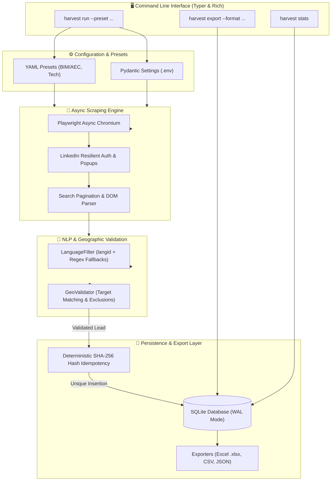

# ⚡ B2B Lead Harvester

[](https://github.com/JuanDie778/b2b-lead-harvester/actions/workflows/ci.yml)
[](https://www.python.org/)
[](https://github.com/psf/black)
[](https://opensource.org/licenses/MIT)

**Enterprise-grade LinkedIn lead extraction & enrichment engine** powered by **Playwright Async**, **NLP Geo-Validation**, **SHA-256 Idempotency**, and a **Rich CLI** interface.

Designed for high-precision prospecting across any industry vertical (AEC/BIM, Tech Startups, SaaS, Legal, Finance) using modular YAML presets without hardcoded domain logic.

---

## 🏛️ System Architecture



---

## ✨ Key Features

- **Domain-Agnostic YAML Presets**: Easily switch targeting by defining keywords, LinkedIn geo URNs, and exclusion rules in declarative YAML files.
- **Deterministic SHA-256 Idempotency**: Prevents duplicate leads across multiple runs using a cryptographic digest: `hash_id = SHA256(author_url + post_url)`.
- **NLP Language & Regional Filtering**: Rejects non-target scripts (Arabic, Devanagari, Bengali, Urdu) via `langid` and regex safeguards; eliminates off-target offshore agencies with word-boundary matchers.
- **Resilient Headless Automation**: Async Playwright with exponential backoff authentication, automated overlay/modal dismissal, and human-like scroll jitter.
- **Multi-Format Export Pipelines**: Clean, one-click export to formatted Excel spreadsheets (`.xlsx` via `openpyxl`), UTF-8-BOM CSV, or structured JSON.
- **Zero-Credential Exposure**: Strict Pydantic Settings reading exclusively from environment variables or `.env`.
- **100% Offline Testable**: Complete `pytest` test suite with mocked DOM fixtures running entirely offline without live network dependencies.

---

## 🚀 Quickstart Guide

### 1. Installation

```bash
# Clone repository
git clone https://github.com/JuanDie778/b2b-lead-harvester.git
cd b2b-lead-harvester

# Create and activate virtual environment
python -m venv .venv
source .venv/bin/activate  # On Windows: .venv\Scripts\activate

# Install package and dependencies
pip install -e .

# Install Playwright browser binaries
playwright install chromium
```

### 2. Environment Configuration

Copy the `.env.example` template and add your LinkedIn credentials:

```bash
cp .env.example .env
```

Edit `.env`:
```ini
LINKEDIN_EMAIL=your_email@example.com
LINKEDIN_PASSWORD=your_secure_password
HEADLESS_MODE=true
DATA_DIR=./data
```

### 3. Usage Examples

#### Run Lead Harvester with a Preset
```bash
# Execute harvesting for BIM & AEC sector (headless)
harvest run --preset config/presets/bim_aec.yaml --limit 50 --headless

# Execute harvesting for Tech Startups & SaaS
harvest run --preset config/presets/tech_startups.yaml --limit 100
```

#### Export Collected Leads
```bash
# Export all leads to an Excel spreadsheet
harvest export --format excel --output ./exports/leads_bim.xlsx

# Export leads filtered by country to CSV
harvest export --format csv --country "United States" --output ./exports/leads_usa.csv

# Export leads to JSON
harvest export --format json --output ./exports/leads.json
```

#### View Telemetry & Database Statistics
```bash
harvest stats
```

---

## 📁 Repository Structure

```
b2b-lead-harvester/
├── .github/
│   └── workflows/
│       └── ci.yml                     # Continuous integration pipeline
├── config/
│   ├── __init__.py
│   ├── settings.py                   # Pydantic v2 Settings for .env management
│   └── presets/
│       ├── bim_aec.yaml              # BIM / Architecture / AEC domain preset
│       └── tech_startups.yaml        # Tech Startups / SaaS domain preset
├── src/
│   └── lead_harvester/
│       ├── __init__.py
│       ├── core/
│       │   ├── __init__.py
│       │   ├── models.py             # Pydantic data entities & SHA-256 hashing
│       │   └── logger.py             # Rich console logger
│       ├── engine/
│       │   ├── __init__.py
│       │   ├── browser.py            # Playwright lifecycle & session manager
│       │   ├── auth.py               # LinkedIn login with exponential retry
│       │   └── scraper.py            # Asynchronous lead extractor
│       ├── nlp/
│       │   ├── __init__.py
│       │   ├── lang_filter.py        # Language classifier (langid + regex fallback)
│       │   └── geo_validator.py      # Location verification & exclusion filters
│       ├── storage/
│       │   ├── __init__.py
│       │   ├── database.py           # SQLite WAL persistence with idempotency
│       │   └── exporters.py          # CSV, Excel (openpyxl), JSON exporters
│       └── cli/
│           ├── __init__.py
│           └── app.py                # Modern Typer & Rich CLI
├── tests/
│   ├── __init__.py
│   ├── conftest.py                   # Mocked DOM & Playwright offline fixtures
│   ├── test_nlp_and_geo.py           # Language & geo unit tests
│   ├── test_storage.py               # SQLite & exporter tests
│   ├── test_cli.py                   # CLI invocation integration tests
│   └── test_core_and_engine.py       # Engine DOM parsing tests
├── .dockerignore
├── .env.example                      # Safe credential-free configuration template
├── .gitignore
├── Dockerfile                        # Containerized Playwright headless runner
├── pyproject.toml                    # Standard Python packaging metadata
├── requirements.txt                  # Locked production dependencies
└── README.md                         # Documentation
```

---

## 🧪 Testing

The test suite runs **100% offline** using mocked DOM handles and fixtures in `tests/conftest.py`:

```bash
pytest -v
```

All tests pass with exit code `0` and zero live external requests.

---

## 🐳 Docker Deployment

Build and run using Docker:

```bash
# Build image
docker build -t b2b-lead-harvester .

# Run stats command
docker run --rm -v $(pwd)/data:/app/data b2b-lead-harvester stats

# Run harvester with mounted environment file
docker run --rm --env-file .env -v $(pwd)/data:/app/data b2b-lead-harvester run --preset config/presets/bim_aec.yaml --limit 25
```

---

## 📄 License

This project is licensed under the [MIT License](LICENSE).
